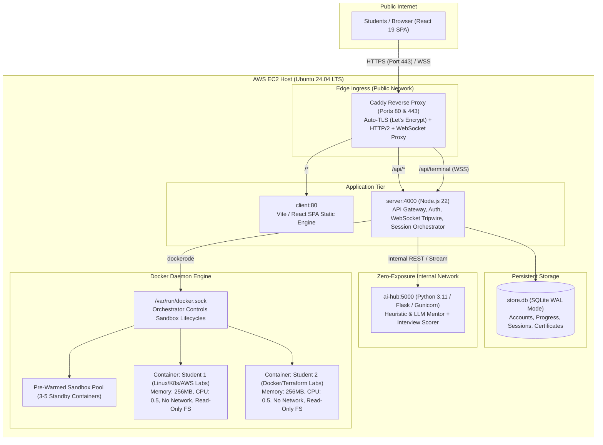

# OpsAcademy Production Deployment Guide (AWS EC2 & Docker Containers)

This runbook guides you through deploying OpsAcademy in production on an **AWS EC2 instance** with isolated Docker sandboxes, automatic Let's Encrypt TLS, SQLite persistence, and container session reconciliation.

---

## 1. Architecture Overview



---

## 2. EC2 Instance Sizing Recommendations

| Target Concurrent Learners | Recommended AWS Instance | vCPU | RAM | EBS Storage | Expected Monthly Cost |
| :--- | :--- | :--- | :--- | :--- | :--- |
| **Up to 25 learners** | `t3.medium` | 2 | 4 GB | 30 GB gp3 | ~$30 / mo |
| **25 to 60 learners** | `t3.large` or `c6i.large` | 2 | 8 GB | 50 GB gp3 | ~$60–$75 / mo |
| **60 to 120 learners** | `c6i.xlarge` or `m6i.xlarge` | 4 | 16 GB | 80 GB gp3 | ~$120–$140 / mo |

> [!NOTE]
> Every student sandbox runs in a lightweight Alpine-based container capped at 256 MB RAM and 0.5 vCPU. The warm standby pool maintains 3–5 pre-spawned containers so sandbox creation takes only 2ms at the median.

---

## 3. Security Group Rules (AWS Firewall)

In the AWS EC2 Management Console, attach a Security Group with the following rules:

| Type | Port Range | Protocol | Source | Purpose |
| :--- | :--- | :--- | :--- | :--- |
| **SSH** | `22` | TCP | `Your IP` (or VPN) | Administrative shell access |
| **HTTP** | `80` | TCP | `0.0.0.0/0` | Let's Encrypt ACME challenge & HTTP to HTTPS redirect |
| **HTTPS** | `443` | TCP | `0.0.0.0/0` | Secure student browser traffic & WebSocket streaming |
| **Grafana** (optional) | `3000` | TCP | `Your IP` | Admin observability dashboard (if profiling enabled) |

> [!IMPORTANT]
> Never open port `4000` (Node Gateway), `5000` (AI Hub), or `/var/run/docker.sock` to the public internet. Caddy on ports 80/443 is the only public ingress.

---

## 4. One-Command Automated Deployment

Connect to your newly provisioned Ubuntu 22.04 or 24.04 LTS instance:

```bash
# 1. Clone repository
git clone https://github.com/yashsrivastava1408/OpsAcademy.git
cd OpsAcademy

# 2. Check out the production architecture branch (or main)
git checkout feature/production-architecture

# 3. Run the automated deployment script
sudo ./scripts/deploy-ec2.sh
```

The script automatically:
1. Installs official Docker Engine and Compose plugin.
2. Applies Linux kernel parameters for high WebSocket concurrency (`fs.file-max`, `inotify` watches, `somaxconn`).
3. Generates `.env.production` with cryptographically secure random secrets for `CERT_SECRET` and `AI_HUB_TOKEN`. You add the Supabase keys yourself.
4. Creates a `systemd` service (`opsacademy.service`) for automatic boot and failure recovery.
5. Builds and launches the complete container stack using `docker-compose.prod.yml`.

---

## 5. Domain Name & TLS Configuration

Edit `.env.production`:

```bash
nano .env.production
```

Configure your real domain and email:

```ini
DOMAIN=learn.yourdomain.com
ACME_EMAIL=admin@yourdomain.com
APP_URL=https://learn.yourdomain.com
CLIENT_URL=https://learn.yourdomain.com
CORS_ORIGINS=https://learn.yourdomain.com
```

Apply changes:

```bash
docker compose -f docker-compose.prod.yml --env-file .env.production up -d --force-recreate proxy
```

Caddy will automatically contact Let's Encrypt and configure valid TLS certificates in ~10 seconds.

---

## 6. Zero-Downtime Session Reconciliation

OpsAcademy includes a container reconciliation engine:
- If you update the server or restart Docker, **existing student sandbox containers continue running on the host**.
- Upon booting, the gateway reads active sessions from the persistent SQLite store (`store.db`) and rebinds to the running containers.
- When students' browsers automatically reconnect over WebSocket, their terminals resume with all files and shell state intact.

To deploy code updates with zero container drops:

```bash
git pull
docker compose -f docker-compose.prod.yml --env-file .env.production build server
docker compose -f docker-compose.prod.yml --env-file .env.production up -d --no-deps server
```

---

## 7. Backups and Maintenance

### Backing up Database & Progress
The SQLite database lives in the `server-data` volume at `/data/store.db`.

To create an online atomic backup without stopping the service:

```bash
docker compose -f docker-compose.prod.yml exec server node -e "
  const { DatabaseSync } = require('node:sqlite');
  const db = new DatabaseSync('/data/store.db');
  db.exec(\"VACUUM INTO '/data/store-backup.db'\");
  console.log('Online backup complete!');
"
```

### Viewing Logs
```bash
# Gateway logs
docker compose -f docker-compose.prod.yml logs -f server

# Caddy access and SSL logs
docker compose -f docker-compose.prod.yml logs -f proxy

# AI Hub logs
docker compose -f docker-compose.prod.yml logs -f ai-hub
```
